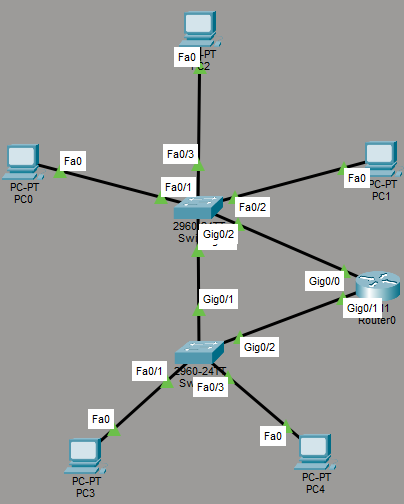
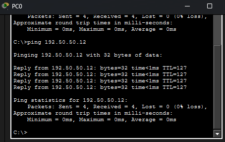
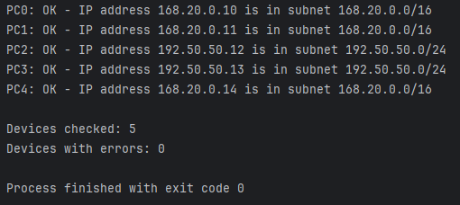
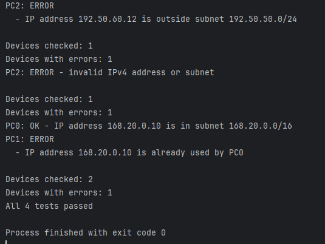

# Small Office Network

An educational project that simulates a small office network in Cisco Packet Tracer. It includes five PCs, two switches, and a router.

Sales and Security are separated into VLANs. A trunk carries both VLANs between the switches, and the router connects their subnets through separate physical interfaces.

A Python script validates the recorded IP address plan, checking address format, subnet membership, and duplicate addresses.

**Tools:** Cisco Packet Tracer · Python 3.12

## Network Topology



| VLAN | Department | Subnet | Gateway |
| --- | --- | --- | --- |
| 10 | Sales | 192.50.50.0/24 | 192.50.50.1 |
| 20 | Security | 168.20.0.0/16 | 168.20.0.1 |

## Verification

Ping tests confirmed connectivity within both VLANs and between subnets.



The Python validator checks all five PCs. Four automated checks cover valid settings, an address outside its subnet, an invalid address, and a duplicate IP.





## Run

Open `small-office-network.pkt` in Cisco Packet Tracer.

Run the validator and tests with Python 3.12:

```bash
python main.py
python test_main.py
```
